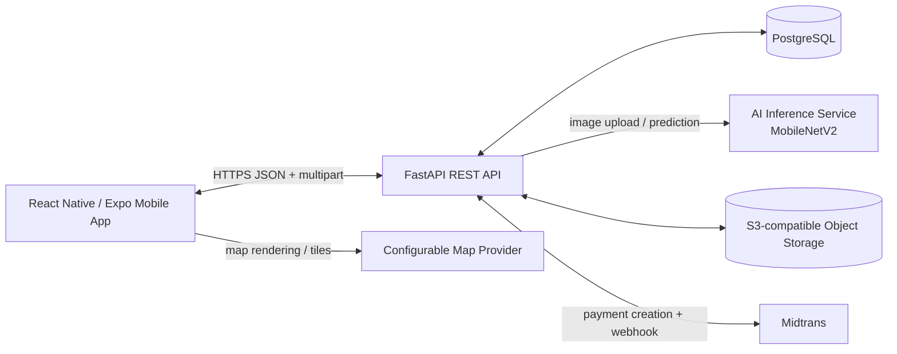
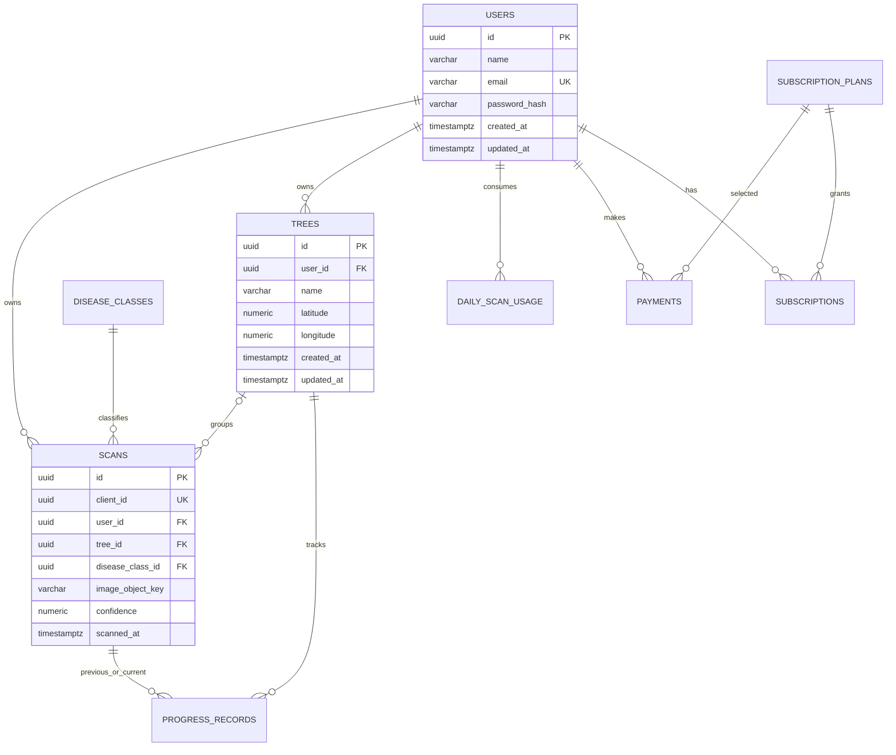

# Sawit Care — Prioritas 0: Arsitektur dan Kontrak Sistem

**Status:** Draft teknis untuk mengunci fondasi implementasi
**Tanggal:** 2026-11-03
**Sumber:** SRS Sawit Care, SDD Sawit Care, keputusan proyek

Dokumen ini menerjemahkan kebutuhan SRS/SDD menjadi keputusan teknis yang dapat dipakai bersama oleh frontend, backend, AI, database, storage, dan integrasi pembayaran. Fitur tidak boleh mengubah kontrak di dokumen ini secara diam-diam; perubahan harus dicatat pada bagian *Decision Log*.

## 1. Keputusan yang sudah dikunci

| Area | Keputusan |
|---|---|
| Client | React Native + Expo + Expo Router, Android sebagai target versi ini |
| Backend | FastAPI/Python dengan REST API melalui HTTPS |
| Database | PostgreSQL dengan UUID sebagai primary key |
| AI | MobileNetV2 server-side; aplikasi tidak menjalankan model AI secara lokal |
| Foto | MinIO saat development; S3-compatible saat production; provider production diatur melalui environment variable |
| Peta | Google Maps melalui `react-native-maps`; API key Android disiapkan saat fitur peta dikerjakan |
| Auth | Access token JWT 15 menit + refresh token opaque 30 hari; refresh token di-hash di PostgreSQL dan token client disimpan menggunakan Expo SecureStore |
| Bahasa/waktu | UI Bahasa Indonesia; waktu bisnis menggunakan WITA (`UTC+08:00`) |
| Paket | Free dan PRO; otorisasi PRO wajib diperiksa backend |
| Pembayaran | Midtrans; status PRO hanya berubah setelah webhook tervalidasi backend |
| Offline | Cache terbatas untuk riwayat, dashboard, dan data peta; scan baru, PDF, dan upgrade memerlukan internet |

## 2. Ruang lingkup versi pertama

### 2.1 Fitur inti

- Registrasi, login, logout, dan session.
- Profil dasar pengguna.
- Pengambilan foto atau pemilihan foto dari galeri.
- Validasi kualitas gambar.
- Upload foto dan prediksi AI.
- Hasil `sehat`/`sakit`, kelas penyakit bila tersedia, confidence score, dan saran.
- Riwayat scan, filter, detail, dan penghapusan.
- Kuota Free maksimal 5 scan per hari dan riwayat Free selama 7 hari.

### 2.2 Fitur lanjutan

- GPS, pohon, marker, dan peta PRO.
- Progress tracking dan timeline.
- Dashboard lanjutan.
- Midtrans dan subscription.
- Export PDF.
- Offline cache dan sinkronisasi.

Fitur lanjutan menggunakan model data dan kontrak inti di dokumen ini; tidak boleh membuat format hasil scan yang berbeda.

## 3. Arsitektur tingkat tinggi



### 3.1 Tanggung jawab komponen

#### Mobile App

- Menampilkan UI dan navigasi.
- Meminta permission kamera, galeri, dan lokasi saat diperlukan.
- Melakukan validasi dasar sebelum upload.
- Mengirim request ke backend.
- Menyimpan token secara aman di SecureStore.
- Menyimpan cache terbatas dan menampilkan status offline.
- Tidak menentukan status PRO secara mandiri.
- Tidak menyimpan password.

#### FastAPI Backend

- Validasi request dan autentikasi.
- Otorisasi user Free/PRO.
- Penerapan kuota dan aturan WITA.
- Orkestrasi upload foto dan inference AI.
- Menyimpan metadata serta hasil ke PostgreSQL.
- Menghasilkan signed URL bila foto perlu diakses client.
- Memproses webhook Midtrans.
- Menjadi sumber kebenaran untuk status subscription dan data scan.

#### AI Service

- Menerima foto yang sudah divalidasi.
- Mengembalikan label model dan confidence.
- Tidak menentukan hak akses user.
- Tidak mengubah status pembayaran.
- Kelas penyakit harus berasal dari konfigurasi/metadata model yang tervalidasi, bukan dari UI.

#### PostgreSQL

- Menyimpan akun, scan, kelas penyakit, pohon, progress, quota, subscription, dan payment metadata.
- Menjadi sumber kebenaran data bisnis.
- Tidak menyimpan binary foto.

#### Object Storage

- Menyimpan file foto asli/hasil yang diizinkan.
- Object key tidak boleh memuat password, token, atau data sensitif.
- Akses file melalui URL terbatas/signed URL bila bucket private.

## 4. Batas sistem dan aliran data utama

### 4.1 Alur scan

```text
User
  -> Mobile: ambil/pilih foto
  -> Mobile: validasi format/ukuran dasar
  -> API: POST /v1/scans dengan multipart image
  -> API: validasi auth, paket, kuota, dan kualitas gambar
  -> Storage: simpan foto
  -> AI: proses MobileNetV2
  -> API: gabungkan prediksi + disease class + recommendation
  -> DB: simpan scan dan penggunaan kuota
  -> Mobile: tampilkan hasil scan
```

### 4.2 Alur login

```text
Mobile -> API: POST /v1/auth/login
API -> DB: cari user dan verifikasi bcrypt
API -> Mobile: access token + refresh token
Mobile -> SecureStore: simpan token
Mobile -> API: request dengan Bearer access token
API -> Mobile: 401 jika access token expired
Mobile -> API: POST /v1/auth/refresh
API -> Mobile: access token baru
```

### 4.3 Alur pembayaran

```text
Mobile -> API: POST /v1/payments
API -> Midtrans: buat transaksi
Midtrans -> Mobile: payment instruction/redirect
Midtrans -> API: webhook status transaksi
API -> Midtrans: verifikasi signature/status
API -> DB: simpan payment dan aktifkan subscription jika settlement
Mobile -> API: GET /v1/subscriptions/me
```

## 5. Kontrak autentikasi

### 5.1 Token

- Access token: JWT, dikirim sebagai `Authorization: Bearer <token>`.
- Refresh token: opaque random token atau JWT yang dapat dicabut; pilihan implementasi final harus konsisten di backend.
- Access token tidak disimpan di AsyncStorage.
- Password tidak pernah dikirim kembali dalam response.
- Semua endpoint selain endpoint publik memerlukan access token.

Access token berlaku 15 menit. Refresh token opaque berlaku 30 hari, disimpan dalam bentuk hash di PostgreSQL, dan dapat dicabut. Client menyimpan token menggunakan SecureStore.

### 5.2 Endpoint auth

| Method | Endpoint | Auth | Fungsi |
|---|---|---:|---|
| `POST` | `/v1/auth/register` | Tidak | Membuat akun dan mengembalikan session |
| `POST` | `/v1/auth/login` | Tidak | Memverifikasi kredensial dan membuat session |
| `POST` | `/v1/auth/refresh` | Refresh token | Mengeluarkan access token baru |
| `POST` | `/v1/auth/logout` | Access token | Mencabut refresh token/session aktif |
| `GET` | `/v1/users/me` | Access token | Mengambil profil pengguna |
| `PATCH` | `/v1/users/me` | Access token | Mengubah nama/email |
| `POST` | `/v1/users/me/password` | Access token | Mengubah password |
| `DELETE` | `/v1/users/me` | Access token | Menghapus akun setelah konfirmasi |

### 5.3 Response session

```json
{
  "user": {
    "id": "uuid",
    "name": "Nama Pengguna",
    "email": "user@example.com",
    "plan": "free",
    "subscription_end_date": null
  },
  "tokens": {
    "access_token": "opaque-value",
    "refresh_token": "opaque-value",
    "token_type": "bearer",
    "expires_in": 900
  }
}
```

Nilai token asli tidak boleh dicatat di log atau dimasukkan ke dokumentasi contoh produksi.

## 6. Kontrak response umum

### 6.1 Sukses

Endpoint mengembalikan object sesuai schema endpoint. Untuk list:

```json
{
  "data": [],
  "meta": {
    "page": 1,
    "page_size": 20,
    "total": 0,
    "has_more": false
  }
}
```

### 6.2 Error

Semua error menggunakan format berikut:

```json
{
  "error": {
    "code": "SCAN_QUOTA_EXCEEDED",
    "message": "Kuota scan hari ini telah habis.",
    "details": null,
    "request_id": "uuid"
  }
}
```

Kode error minimum:

| HTTP | Code | Arti |
|---:|---|---|
| 400 | `VALIDATION_ERROR` | Input tidak valid |
| 401 | `UNAUTHENTICATED` | Token tidak ada/tidak valid |
| 401 | `TOKEN_EXPIRED` | Access token kedaluwarsa |
| 403 | `PRO_REQUIRED` | Fitur hanya untuk PRO |
| 404 | `RESOURCE_NOT_FOUND` | Data tidak ditemukan |
| 409 | `EMAIL_ALREADY_EXISTS` | Email sudah digunakan |
| 409 | `DUPLICATE_REQUEST` | Idempotency/UUID sudah diproses |
| 413 | `FILE_TOO_LARGE` | File melebihi batas |
| 422 | `IMAGE_NOT_VALID` | Foto gagal validasi |
| 429 | `SCAN_QUOTA_EXCEEDED` | Kuota Free habis |
| 500 | `INTERNAL_ERROR` | Error server yang tidak terduga |
| 502 | `AI_SERVICE_UNAVAILABLE` | AI tidak tersedia |
| 503 | `PAYMENT_SERVICE_UNAVAILABLE` | Midtrans tidak tersedia |

## 7. Kontrak endpoint domain inti

### 7.1 Scan

| Method | Endpoint | Auth | Paket |
|---|---|---:|---:|
| `POST` | `/v1/scans` | Ya | Free/PRO |
| `GET` | `/v1/scans` | Ya | Free/PRO |
| `GET` | `/v1/scans/{scan_id}` | Ya | Free/PRO |
| `DELETE` | `/v1/scans/{scan_id}` | Ya | Free/PRO |
| `GET` | `/v1/scans/quota` | Ya | Free/PRO |

`POST /v1/scans` menggunakan `multipart/form-data`:

- `image`: file wajib.
- Format yang diterima: JPEG, PNG, atau WebP.
- Ukuran maksimum: 10 MB.
- Sisi terpanjang maksimum: 2048 px.
- `client_id`: UUID yang dibuat client untuk idempotency/offline trace.
- `tree_id`: UUID opsional untuk fitur PRO setelah pohon tersedia.

Response sukses:

```json
{
  "data": {
    "id": "uuid",
    "client_id": "uuid",
    "status": "sakit",
    "disease": {
      "model_label": "MODEL_LABEL",
      "name": null,
      "is_healthy": false
    },
    "confidence": 87.5,
    "image_url": "https://signed-url.example/image",
    "recommendation": {
      "cause": "...",
      "symptoms": "...",
      "treatment": "..."
    },
    "scanned_at": "2026-11-03T10:30:00+08:00"
  }
}
```

`confidence` adalah keyakinan model, bukan tingkat keparahan penyakit. Dataset dan model AI belum tersedia, sehingga nama kelas penyakit belum dikunci. Kontrak menggunakan `model_label`, `name` yang dapat bernilai `null`, dan `is_healthy`. Daftar kelas final ditetapkan setelah dataset dan model tervalidasi.

### 7.2 Riwayat

Query minimum untuk `GET /v1/scans`:

- `status=all|healthy|sick`
- `sort=latest|oldest`
- `page`
- `page_size`

Backend menerapkan batas 7 hari untuk user Free. Client tidak boleh mengambil seluruh riwayat lalu memotongnya sendiri.

### 7.3 Dashboard

| Method | Endpoint | Auth | Paket |
|---|---|---:|---:|
| `GET` | `/v1/dashboard/summary` | Ya | Free/PRO |

Query:

- `from`: tanggal WITA opsional.
- `to`: tanggal WITA opsional.

Response minimum:

```json
{
  "data": {
    "total_scans": 0,
    "healthy_scans": 0,
    "sick_scans": 0,
    "sick_tree_count": 0,
    "last_updated_at": "2026-11-03T10:30:00+08:00"
  }
}
```

### 7.4 PRO: tree, map, progress

Endpoint yang disiapkan sejak awal agar relasi data tidak berubah:

| Method | Endpoint | Fungsi |
|---|---|---|
| `POST` | `/v1/trees` | Membuat marker pohon |
| `GET` | `/v1/trees` | Mengambil marker dan filter |
| `PATCH` | `/v1/trees/{tree_id}` | Mengubah label/koordinat |
| `DELETE` | `/v1/trees/{tree_id}` | Menghapus marker, scan tetap ada |
| `POST` | `/v1/trees/{tree_id}/progress` | Membuat progress dari scan sebelumnya |
| `GET` | `/v1/trees/{tree_id}/timeline` | Mengambil timeline progress |

Semua endpoint tersebut memerlukan status PRO dari backend.

## 8. Model data dan aturan relasi



Aturan penting:

- `scans.user_id` wajib membatasi akses data berdasarkan pemilik.
- `scans.tree_id` nullable karena scan biasa boleh tidak memiliki lokasi.
- Menghapus tree tidak menghapus scan; `tree_id` menjadi null atau mengikuti aturan FK yang dipilih.
- `client_id` harus unik per user untuk mencegah duplikasi request/sinkronisasi.
- `daily_scan_usage` menggunakan kombinasi `user_id + usage_date`.
- Kuota yang sudah terpakai tidak kembali walaupun scan dihapus.
- Semua timestamp disimpan dengan timezone dan ditampilkan dalam WITA.

## 9. Aturan paket dan kuota

| Aturan | Free | PRO |
|---|---:|---:|
| Scan | 5 per tanggal WITA | Tidak dibatasi oleh aturan Free |
| Riwayat | 7 hari terakhir | Sesuai kebijakan produk |
| GPS/peta | Tidak | Ya |
| Progress/timeline | Tidak | Ya |
| Export PDF | Tidak | Ya |
| Dashboard | Ringkasan dasar | Ringkasan lanjutan |

Backend memeriksa paket pada setiap request yang membutuhkan PRO. UI hanya membantu pengalaman pengguna dan bukan lapisan keamanan.

## 10. Validasi kualitas gambar

Validasi dilakukan dua lapis:

1. **Client-side:** format, ukuran file, dimensi dasar, dan pemeriksaan cepat jika library tersedia.
2. **Backend-side:** validasi wajib sebelum foto dikirim ke AI; hasil backend menjadi sumber keputusan.

Jika invalid, backend mengembalikan `422 IMAGE_NOT_VALID` dengan detail yang dapat ditampilkan client, misalnya:

```json
{
  "error": {
    "code": "IMAGE_NOT_VALID",
    "message": "Foto belum layak dianalisis.",
    "details": {
      "reasons": ["too_dark", "blurry"]
    },
    "request_id": "uuid"
  }
}
```

Threshold blur dan brightness belum boleh dikunci berdasarkan perkiraan. Threshold ditentukan melalui eksperimen dataset/foto nyata setelah dataset tersedia, lalu disimpan sebagai konfigurasi backend dan dicatat bersama hasil pengujian.

## 11. Offline dan sinkronisasi

### 11.1 Yang boleh diakses offline

- Riwayat scan yang sudah tercache.
- Ringkasan dashboard yang sudah tercache.
- Data marker/peta yang sudah tercache.

### 11.2 Yang memerlukan koneksi

- Scan baru dan inference AI.
- Export PDF.
- Upgrade PRO.
- Login/registrasi baru.
- Sinkronisasi ke server.

### 11.3 Kontrak cache

Cache menyimpan:

- `data`.
- `cached_at` dalam WITA.
- `schema_version`.
- `last_sync_cursor` bila pagination/sync cursor digunakan.

Cache corrupt atau schema tidak cocok harus dihapus dan tidak boleh membuat aplikasi crash.

### 11.4 Idempotency dan retry

- Client membuat UUID untuk operasi yang mendukung sinkronisasi.
- Request ulang dengan `client_id` yang sama harus mengembalikan hasil yang sama atau `DUPLICATE_REQUEST`, bukan membuat data baru.
- Retry hanya untuk kegagalan jaringan/time-out, bukan untuk validation error atau permission error.
- Konflik update tree menggunakan `updated_at`/versi server; kebijakan default adalah server menang dan client menerima data terbaru.
- Queue lokal tidak boleh mengirim password atau token sebagai payload.

## 12. Keamanan minimum

- HTTPS untuk seluruh komunikasi non-local.
- Password di-hash dengan bcrypt di backend.
- SQL menggunakan parameterized query/ORM.
- CORS dibatasi untuk origin yang diperlukan.
- File storage private secara default.
- Signed URL memiliki masa berlaku terbatas.
- Webhook Midtrans memverifikasi signature/status sebelum mengaktifkan PRO.
- Log tidak boleh berisi password, token, atau URL signed yang masih aktif.
- Rate limit diterapkan pada login, refresh, dan endpoint upload.

## 13. Keputusan yang ditunda secara resmi

Keputusan berikut sengaja ditunda karena membutuhkan input atau pengujian yang belum tersedia. Penundaan ini tidak memblokir fondasi MVP selama interface yang sudah ditentukan tetap dipatuhi:

1. Dataset dan model AI belum tersedia; daftar kelas penyakit final belum dapat ditetapkan.
2. Threshold blur/brightness ditetapkan setelah eksperimen dataset/foto nyata.
3. Paket PRO: harga, durasi, dan aturan perpanjangan belum ditetapkan; nilai disimpan sebagai konfigurasi.

## 14. Definition of Done Prioritas 0

Prioritas 0 dianggap selesai apabila:

- Keputusan teknologi utama disetujui.
- Diagram arsitektur tersedia.
- Batas tanggung jawab setiap komponen jelas.
- Model data inti dan aturan relasi disepakati.
- Daftar endpoint inti tersedia.
- Schema auth, scan, list, dan error tersedia.
- Aturan Free/PRO dan kuota tersedia.
- Alur pembayaran, GPS, dan offline memiliki batas yang jelas.
- Semua keputusan terbuka diberi pemilik dan target keputusan.
- Perubahan berikutnya dicatat dalam *Decision Log*.

## 15. Decision Log

| ID | Keputusan | Status |
|---|---|---|
| ADR-001 | Client Expo/React Native, backend FastAPI, PostgreSQL | Disetujui |
| ADR-002 | AI berjalan server-side menggunakan MobileNetV2 | Disetujui dari SRS/SDD |
| ADR-003 | Foto disimpan di object storage S3-compatible | Disetujui |
| ADR-004 | Google Maps melalui `react-native-maps` | Disetujui |
| ADR-005 | Access token 15 menit + refresh token opaque 30 hari; refresh token di-hash di PostgreSQL dan token client di SecureStore | Disetujui |
| ADR-006 | Status PRO hanya berubah setelah webhook Midtrans tervalidasi | Disetujui dari SRS/SDD |
| ADR-007 | MinIO untuk development dan S3-compatible production melalui environment variable | Disetujui |
| ADR-008 | Foto JPEG/PNG/WebP, maksimal 10 MB dan sisi terpanjang 2048 px | Disetujui |
| ADR-009 | Scan gagal sebelum hasil valid tersimpan tidak mengurangi kuota | Disetujui |
| ADR-010 | Tren: sakit→sehat membaik, label sama tetap, sehat→sakit memburuk; confidence hanya ditampilkan | Disetujui |
| ADR-011 | Nama penyakit belum dikunci sebelum dataset dan model tersedia/tervalidasi | Disetujui |
| ADR-012 | Offline terbatas pada data yang sudah tercache | Disetujui dari SRS/SDD |
